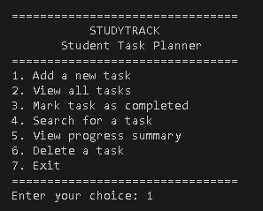
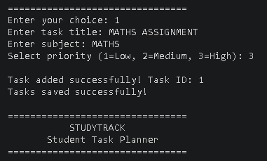
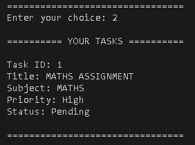
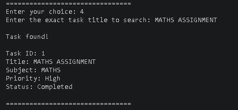
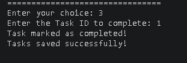
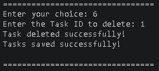
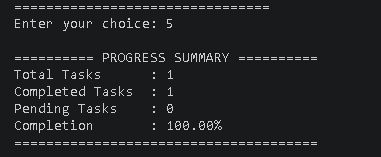
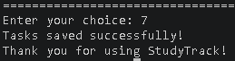

# StudyTrack — Student Task Planner

StudyTrack is a menu-driven student task planner developed using the C programming language. It helps students organize academic tasks, manage priorities, track completion progress, and save their tasks for future use.

## Features

- **Add Tasks:** Create tasks with a title, subject, and priority.
- **View Tasks:** Display all tasks with their details and status.
- **Unique Task IDs:** Assign a unique ID to each task.
- **Complete Tasks:** Mark tasks as completed.
- **Search Tasks:** Find tasks using their exact title.
- **Progress Summary:** View total, completed, and pending tasks with a completion percentage.
- **Delete Tasks:** Remove tasks by their ID.
- **File Handling:** Save tasks to `tasks.txt` and load them when the program starts.
- **Input Validation:** Handle invalid menu choices and task priorities.

## Screenshots

### 1. Main Menu

The main menu provides access to all the features of StudyTrack.



### 2. Add a Task

Create a task by entering its title, subject, and priority.



### 3. View Tasks

View task details, including their IDs, subjects, priorities, and completion statuses.



### 4. Search Tasks

Search for a task using its exact title.



### 5. Complete a Task

Mark a task as completed using its unique Task ID.



### 6. Delete a Task

Delete a task using its Task ID.



### 7. Progress Summary

Track the total number of tasks, completed tasks, pending tasks, and completion percentage.



### 8. Save and Exit

Exit the application after saving the task data.



## Technologies Used

- C Programming Language
- GCC Compiler
- Visual Studio Code
- Git and GitHub

## Concepts Practiced

This project applies the following C programming concepts:

- Structures (`struct`)
- Arrays and strings
- Functions and pointers
- Loops and conditional statements
- String comparison using `strcmp()`
- Input validation
- File handling using `fopen()`, `fgets()`, `fprintf()`, and `fclose()`

## Project Structure

```text
STUDYBUDDY/
├── Screenshots/
│   ├── add-task.png
│   ├── complete-task.png
│   ├── delete-task.png
│   ├── exit.png
│   ├── main-menu.png
│   ├── review-task.png
│   ├── search-task.png
│   └── view-tasks.png
├── main.c
├── README.md
├── .gitignore
└── tasks.txt
```

## How to Run

### Prerequisites

Install GCC or another compatible C compiler and ensure it is available in your terminal.

### Compile the program

Open the project folder in VS Code and run:

```bash
gcc main.c -o StudyTrack.exe
```

### Run on Windows

```powershell
.\StudyTrack.exe
```

The program stores task information in `tasks.txt` so that saved tasks can be loaded during a future run.

## Future Improvements

- Add task deadlines and due dates.
- Sort tasks by priority.
- Search tasks by subject.
- Add overdue-task reminders.
- Improve task filtering and the user interface.

## Learning Outcome

Building StudyTrack helped me practise fundamental C programming concepts by applying them to a practical student task management application. It provided experience with functions, structures, input validation, and persistent file storage.

---

**Project:** StudyTrack — Student Task Planner  
**Language:** C  
**Project Level:** Beginner
